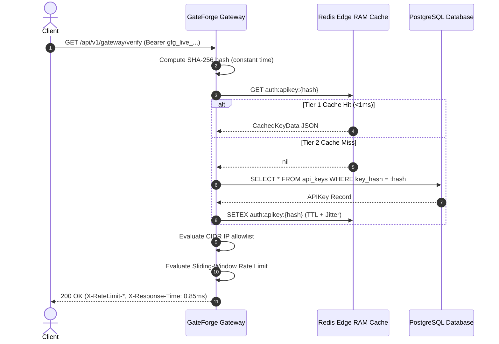

# GateForge Architecture & System Design

GateForge is an enterprise-grade API key lifecycle manager, sub-millisecond edge authentication gateway, distributed sliding-window rate limiter, and real-time telemetry engine.

```
+-----------------------------------------------------------------------------+
|                                Client Request                               |
+-----------------------------------------------------------------------------+
                                       | (Bearer Token / X-Request-ID)
                                       v
+-----------------------------------------------------------------------------+
|                            GateForge Gateway Edge                           |
|  - High-Precision Latency Timing Middleware                                 |
|  - Correlation ID Injection & Diagnostic Propagation                        |
|  - Prometheus Latency Buckets & Real-time Metrics                           |
+-----------------------------------------------------------------------------+
                                       |
                +----------------------+----------------------+
                |                                             |
                v                                             v
+-----------------------------------+         +-------------------------------+
|      Tier 1: Edge Redis Cache     |         |  Tier 2: Async PostgreSQL DB  |
|  - Sub-millisecond lookup (<1ms)  | --MISS- |  - Cryptographic SHA-256 hash |
|  - Anti-stampede random jitter    |         |  - Strict relational schemas  |
|  - Invalidation purge hooks       |         |  - Compound query indexing    |
+-----------------------------------+         +-------------------------------+
                |                                             |
                +----------------------+----------------------+
                                       |
                                       v
+-----------------------------------------------------------------------------+
|                      Security & Policy Enforcement                          |
|  - Enterprise CIDR Block & Single IP Allowlisting                           |
|  - Granular RBAC Permission Scopes Validation                               |
+-----------------------------------------------------------------------------+
                                       |
                                       v
+-----------------------------------------------------------------------------+
|              Distributed Sliding-Window Rate Limiter (Redis Lua)             |
|  - Atomic ZREMRANGEBYSCORE + ZADD + ZCARD + EXPIRE execution                |
|  - RFC 6585 Standard Headers: X-RateLimit-Limit, Remaining, Reset           |
|  - Tier-based quotas + Custom per-key RPM overrides                         |
+-----------------------------------------------------------------------------+
                                       |
                                       v
+-----------------------------------------------------------------------------+
|                   Asynchronous Non-Blocking Telemetry                       |
|  - Zero-latency-impact bounded in-memory buffer                             |
|  - Resilient background worker draining into PostgreSQL batches             |
|  - Time-series analytics queries (p50, p95, p99, throughput, quota alerts)  |
+-----------------------------------------------------------------------------+
```

---

## 1. Sub-Millisecond Two-Tier Edge Authentication

GateForge delivers `<1ms` authentication latencies via a two-tier cache design:



### Anti-Cache Stampede Protection
When hundreds of concurrent requests arrive simultaneously for a newly issued or expired key, traditional caching mechanisms suffer from cache stampedes. GateForge implements **bounded random jitter** (`ttl = base_ttl + rand(0, 30s)`), decorrelating cache expiration boundaries across instances.

---

## 2. Distributed Sliding-Window Rate Limiter

Traditional fixed-window and token-bucket algorithms suffer from burst boundary vulnerabilities where clients can send $2\times$ their quota at window edges. GateForge utilizes a rolling sliding-window rate limiting engine powered by an atomic Redis Lua script:

```lua
local key = KEYS[1]
local now = tonumber(ARGV[1])
local window = tonumber(ARGV[2])
local max_requests = tonumber(ARGV[3])
local clear_before = now - window

-- 1. Remove expired request timestamps
redis.call('ZREMRANGEBYSCORE', key, 0, clear_before)

-- 2. Count current requests in rolling window
local current_requests = redis.call('ZCARD', key)

-- 3. Check quota capacity
if current_requests < max_requests then
    redis.call('ZADD', key, now, now .. '-' .. redis.call('INCR', key .. ':seq'))
    redis.call('EXPIRE', key, math.ceil(window))
    return {1, max_requests - current_requests - 1, 0}
else
    local oldest = redis.call('ZRANGE', key, 0, 0, 'WITHSCORES')
    local retry_after = math.max(1, math.ceil((tonumber(oldest[2]) + window) - now))
    return {0, 0, retry_after}
end
```

### Guarantees:
1. **Strict Atomicity:** Lua scripts execute atomically in Redis single-threaded engine, preventing concurrent race conditions.
2. **Zero Boundary Drift:** Precise sub-second sliding window inspection guarantees rate limits cannot be bypassed by splitting traffic across clock minutes.
3. **RFC 6585 Compliance:** Automatically returns `X-RateLimit-Limit`, `X-RateLimit-Remaining`, `X-RateLimit-Reset`, and `Retry-After`.

---

## 3. High-Throughput Asynchronous Telemetry Engine

Request auditing and usage rollups must never introduce latency into the critical authentication path:
- Telemetry payloads (`RequestTelemetry`) are enqueued into a bounded async queue (`asyncio.Queue`) in non-blocking mode.
- A resilient background flusher service drains the queue in micro-batches (up to 100 records or 1-second timeout).
- Drained batches are inserted into PostgreSQL with compound indices optimized for time-series aggregation (`timestamp`, `key_id`, `status_code`).
- Rolling aggregate services calculate p50, p90, p95, p99 latencies and quota utilization metrics on demand.
